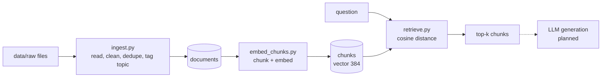

# RAG Pipeline with pgvector

A retrieval-augmented generation (RAG) data pipeline built on Postgres and pgvector. It ingests a mixed corpus of PDFs, cleans and deduplicates the text, splits it into overlapping chunks, embeds them, stores the vectors in Postgres, and retrieves the most relevant chunks for a question. A small evaluation harness measures retrieval quality so that every design change can be judged against a baseline.

**Status:** ingestion, chunking, embedding, retrieval, and evaluation work. LLM answer generation is not built yet (see the roadmap).

## Highlights

- **Idempotent pipeline.** Re-running ingestion or embedding never creates duplicates. Upserts update a row only when its content or topic actually changed.
- **Defensive ingestion.** Hidden folders (such as Jupyter checkpoints) are skipped, and files with identical content under different paths are detected by content hash.
- **Tested chunking.** `chunk_text` has unit tests for the edge cases (empty text, text shorter than the window, exact-fit windows, redundant tails, invalid overlap).
- **Measured retrieval.** A 10-question evaluation set reports hit rate at top 3. Baseline: **8 of 10 (80%)**.
- **Documented data quality issues.** The "Findings" section lists real problems found in the data and what was done about each.

## Architecture



## Stack

| Layer | Choice |
|---|---|
| Language | Python |
| Database | Postgres 16 with pgvector, run in Docker |
| PDF text extraction | pypdf |
| Embeddings | sentence-transformers, `all-MiniLM-L6-v2` (384 dimensions) |
| DB driver | psycopg 3 with the pgvector adapter |
| Tests | pytest |

## Repository layout

```
.
├── README.md
├── docker-compose.yml        # Postgres + pgvector
├── requirements.txt
├── .env.example              # connection settings, no real secrets
├── data/raw/                 # input documents (git-ignored)
│   ├── guides/
│   ├── interviews/
│   ├── papers/
│   └── slides/
├── src/
│   ├── ingest.py             # read, clean, dedupe, load into documents
│   ├── chunking.py           # chunk_text
│   ├── embed_chunks.py       # chunk, embed, load into chunks
│   ├── retrieve.py           # vector search with optional topic filter
│   └── evaluate.py           # hit rate at top k
├── tests/test_chunking.py
└── eval/questions.json       # evaluation questions with expected sources
```

## Running it

```bash
cp .env.example .env                 # then set a password
docker compose up -d                 # start Postgres + pgvector
python -m venv .venv && source .venv/bin/activate
pip install -r requirements.txt

python src/ingest.py                 # load documents
python -m src.embed_chunks           # chunk + embed
python -m src.evaluate               # retrieval hit rate
python -m pytest -v                  # unit tests
```

<!-- TODO: confirm these commands match your repo exactly, then delete this comment -->

## Data

The documents are not committed to this repository (`data/` is git-ignored). The corpus is organized by topic folder, and the folder name becomes the document's `topic` column.

| Topic | Documents | Chunks | Contents |
|---|---|---|---|
| guides | 10 | 2,153 | Data engineering guides and ebooks |
| interviews | 12 | 771 | Interview Q&A material, including a practice exam |
| papers | 4 | 478 | Research papers and a vendor whitepaper (Kafka, Delta Lake, Lakehouse) |
| slides | 2 | 932 | Google Cloud course decks |
| **Total** | **28** | **4,334** | |

**Sources and licenses:** <!-- TODO: list each source, its URL, and its license. Confirm licenses before describing any file as redistributable. -->

## Design decisions

- **Upsert on `source_path`, keyed by content hash.** Unchanged files are not rewritten, which makes re-runs cheap and safe. The update condition also fires when the topic changes (`IS DISTINCT FROM`), so reorganizing folders self-corrects on the next run.
- **Duplicate detection by hash.** If the same content appears under a second path, the second copy is skipped and logged. The first path processed wins.
- **Topic from the folder name.** Files directly under `data/raw/` get `unknown`. Retrieval can exclude topics, which the evaluation uses to leave out interview Q&A by default.
- **Topic stored once, on `documents`.** Chunks reach it through a join, so there is one source of truth and no copy to keep in sync.
- **Chunks keyed by `(document, index, size, overlap)`.** Several chunking configurations can coexist in one table, so experiments do not overwrite each other.
- **Cosine distance** (`<=>`) for similarity, with a filter on the chunking configuration so each search uses one configuration.

## Results

**Corpus:** 4,334 chunks at 500 characters with 75 overlap. Chunk length is min 91, average 499, max 500. Only 2 chunks are shorter than 100 characters.

**Retrieval baseline** (10 questions, top 3, `interviews` excluded, chunk size 500, overlap 75):

| Metric | Result |
|---|---|
| Hit rate at 3 (right document appears in top 3) | **8 / 10 = 80%** |
| Misses | Question 1 (stream vs batch) and question 7 (data engineers and ML in production) |

<!-- TODO: after reading the chunks for each miss, record whether it was a retrieval failure, an ambiguous question, or a wrong label -->

**How to read this:** with ten questions, one question moves the score by 10 points, so differences smaller than that are noise. The metric is also lenient: a hit means the right *document* appeared, not that the chunk contains the answer.

<!-- TODO: add the second configuration (for example 1000 / 150) once run, and record model.max_seq_length -->

## Findings

Problems found in the data and pipeline, and what was done about each.

| Finding | Cause | Action |
|---|---|---|
| Duplicate document in the table | Jupyter's hidden `.ipynb_checkpoints` folder sat inside `data/raw/` and was ingested | Skip hidden folders, keep notebooks in a separate folder, dedupe by content hash |
| Lines showing a trailing `+` | Not in the data. `psql` marks multi-line values with `+` in aligned output | Verified with unaligned output (`psql -A`); no cleaning rule needed |
| Cover page extracted one word per line | PDF layout puts each word in its own text block | Join hard-wrapped lines inside paragraphs, keep blank-line paragraph breaks |
| Words split by a hyphen at line ends | PDF line wrapping | Rejoin them. Side effect: genuine hyphens at a line break are lost (for example "first-class" became "firstclass") |
| Soft hyphens (`\xad`) and non-breaking spaces (`\xa0`) in text | Characters PDFs insert for layout | Normalize them (see roadmap if not yet in `clean()`) |
| A practice exam ranked in the top 3 for a Delta Lake question | The exam contains deliberately wrong answer options, which are topically similar to correct text | Added a topic filter so Q&A material can be excluded from search |
| One guide holds about 22% of all chunks and appears in many top-3 results | Chunk count follows document length, so long documents get more chances to match | Noted as retrieval bias; see roadmap |
| Some top-3 results are three overlapping chunks from one passage | 75-character overlap between neighboring chunks | Noted; diversity-aware retrieval is on the roadmap |
| `Multiple definitions in dictionary ... /ToUnicode` warning from one paper | Malformed font-mapping table in that PDF | Checked the extracted text, which read cleanly, so the warning was ignored |
| `fontTools is required` message | `pypdf` needs `fonttools` for some CFF fonts | Added `fonttools` to requirements |

## Known limitations

- Answer generation is not implemented, so the pipeline stops at retrieval.
- The evaluation set is small (10 questions) and document-level, so it cannot show whether a retrieved chunk actually answers the question.
- Character-based chunking can cut words and sentences in the middle.
- Cover pages and tables of contents are embedded like real content and can match queries without answering them.
- Scanned (image-only) PDFs produce no text, and no OCR is attempted.
- Rows for files deleted from disk are not removed, and a document whose text shrinks can leave surplus old chunks behind.
- Only exact duplicates are detected. Near-duplicates, such as two versions of the same paper, are not.

## Roadmap

Roughly in order of value:

1. **Answer generation.** Pass the retrieved chunks and the question to an LLM, and tell it to answer only from the context.
2. **Compare chunk configurations.** Run a second size and overlap (for example 1000 / 150), check the embedding model's maximum input length first, and compare hit rates.
3. **Chunk-level evaluation.** Check whether the retrieved chunk contains the answer, not only whether the right document appeared. Add more questions and a rank-based metric such as MRR.
4. **Word- or sentence-aware chunking.** Back up to the last space or sentence boundary so chunks do not start mid-word.
5. **Diversity in results.** Reduce near-duplicate neighbors in the top k (for example with maximal marginal relevance).
6. **Hybrid search.** Combine keyword search with vector search, and consider a reranker.
7. **Cleaner text.** Remove repeated headers and footers, tables of contents, and cover pages.
8. **Lifecycle handling.** Detect deleted files and shrunken documents, and remove stale rows and chunks.
9. **Performance.** Add an HNSW index once the table grows.
10. **Engineering polish.** Run the tests in CI, and orchestrate the steps with a scheduler such as Airflow with dbt for transformations.

## Learning log

- Environment: Docker, Postgres, pgvector, Python virtual environment, GitHub.
- Embeddings and nearest-neighbor search with pgvector.
- Ingestion with cleaning, hashing, and topic tagging.
- Chunking written from scratch, with tests written first.
- Retrieval with a topic filter, and a first evaluation baseline.
- Debugging lessons: Jupyter and the virtual environment must use the same Python, `psql` display markers are not data, and silent bugs (wrong variable, `NULL` comparisons) are the ones worth testing for.

## Credits

<!-- TODO: credit the sources of the documents and any tutorials you used -->